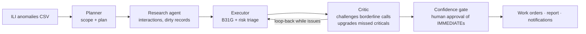

# CorrosionGuard

Agentic AI that triages pipeline corrosion ILI findings by risk — and catches missed critical defects.
Offline PoC: **Streamlit + LangGraph + deterministic Mock LLM**. No paid APIs, no internet at runtime.

> **Synthetic data only.** Engineering formulas are **simplified educational approximations**,
> **NOT for real integrity decisions.**

## Problem

Pipeline operators review thousands of inline-inspection (ILI) corrosion anomalies by hand. Missed
critical defects (predicted time-to-failure under a year) become leaks, ruptures or regulator
findings; over-escalated ones waste scarce engineer hours. This PoC asks: can a small multi-agent
system triage anomalies by risk, explain every decision, and catch the criticals that plain rule
tables miss — fully offline, no paid APIs?

**What it does:** Planner scopes the run → Research enriches context (interacting anomalies,
dirty records) → Executor triages with engineering tools (simplified B31G, risk scoring) →
Critic challenges borderline calls, upgrades missed criticals and loops back → confidence gate
for human approval → work orders, report and notifications for approved items.

## Setup & run

```bash
git clone https://github.com/DeltaN04/Pipeline-Corrosion-Guard && cd Pipeline-Corrosion-Guard
python3 -m venv .venv && .venv/bin/python -m pip install -r requirements.txt  # or: uv pip install ...
.venv/bin/python data/generate_data.py        # regenerate synthetic data (seed 42)
.venv/bin/python -m pytest tests/ -q          # validation suite (23 tests)
.venv/bin/python -m streamlit run app.py      # launch UI  →  http://localhost:8501
```

One-command equivalent: `pip install -r requirements.txt && streamlit run app.py`

## 3-minute demo script

1. **Home** (30 s): problem statement + manual-vs-agentic table.
2. **Data** (20 s): *Load built-in synthetic data* → 300 anomalies, quality report (15 dirty records flagged).
3. **Run Agents** (60 s): scope `ALL`, **Run Triage** → watch Planner plan, Research enrichment
   (interacting/dirty counts), Executor triage, Critic upgrades, loop-back iterations, escalation, A2A trace.
4. **Triage Results** (20 s): sortable table + Plotly charts (class mix, risk vs chainage, depth vs growth).
5. **Critic Findings** (20 s): missed criticals caught, before/after legacy labels, per-item explanation.
6. **Human Approval** (20 s): approve/reject IMMEDIATEs → confirm → download work orders/report/notifications.
7. **Validation** (20 s): recall bars legacy 0.85 → executor 0.83 → final **0.98**; time-saved assumption stated.
8. **Architecture** (10 s): diagram + agent cards + LangGraph flow.

## Headless smoke test (no browser)

```bash
.venv/bin/python src/graph/runner.py data/ili_anomalies.csv
```

## How it works



Key design decisions:

- **Deterministic mock LLM by default** — every run is reproducible and the audit trail is honest;
  swap to a local model (`LLM_BACKEND="ollama"`) with a one-line change in `src/llm/provider.py`.
- **Critic loop-back is the point** — the critic upgrades missed criticals and explains each change;
  this is where validation recall moves 0.85 → 0.98.
- **Human approval gate** — nothing is finalised until a human confirms IMMEDIATE-class findings.
- **Offline and free** — no network at runtime; Streamlit UI over a local synthetic CSV.

## Assumptions

- Manual review baseline: 20 min/anomaly (stated in UI + REPORT; adjust to your shop's number).
- Critical defect = final class IMMEDIATE or 60_DAY (for recall/precision).
- Simplified Modified B31G with flow stress 1.1×SMYS; interaction threshold 1.0 m chainage.
- Mock LLM output is template text — a stand-in for rationales, not engineering judgment.
- `LLM_BACKEND="mock"` in `src/llm/provider.py`; swap to `"ollama"` (+ `langchain-ollama`) for a real model.

## Project structure

```
corrosionguard/
  app.py  requirements.txt  README.md  REPORT.md  build_ppt.py  conftest.py
  data/  generate_data.py  ili_anomalies.csv
  src/agents/  planner, research, executor, critic, automation
  src/graph/  state, builder (LangGraph), runner (headless), a2a (bus + agent cards)
  src/tools/  b31g, risk, lookup, clustering, quality
  src/llm/  provider (one-line swap), mock_model (BaseChatModel)
  src/schemas/  pydantic models
  tests/  7 files, 23 tests
  docs/  architecture.md, architecture.png, generate_diagram.py
  outputs/  work orders, summaries, notifications (generated at runtime)
```

## Results & validation

- **23 pytest tests** over the agent logic, tools and schemas.
- End-to-end triage on the synthetic benchmark (300 anomalies, 15 dirty records flagged):
  final missed-critical recall **0.98** vs **0.85** for legacy labels — upgrades come from the
  critic's loop-back and are explained per item.
- The manual-review baseline (20 min/anomaly) is an explicit assumption, stated in the UI and
  REPORT — adjust to your shop's number.

## Limitations & future work

- Synthetic data and simplified engineering formulas (Modified B31G, 1.1×SMYS, 1.0 m interaction
  threshold) — educational use only, **not for real integrity decisions**.
- Mock LLM rationales are template text; a real local model would enrich research and explanations.
- Future: real ILI datasets and full code suite (RSTRENG), GIS/chainage map integration,
  persistence + auth for multi-user deployment, scheduled re-triage as new inspection runs land.
