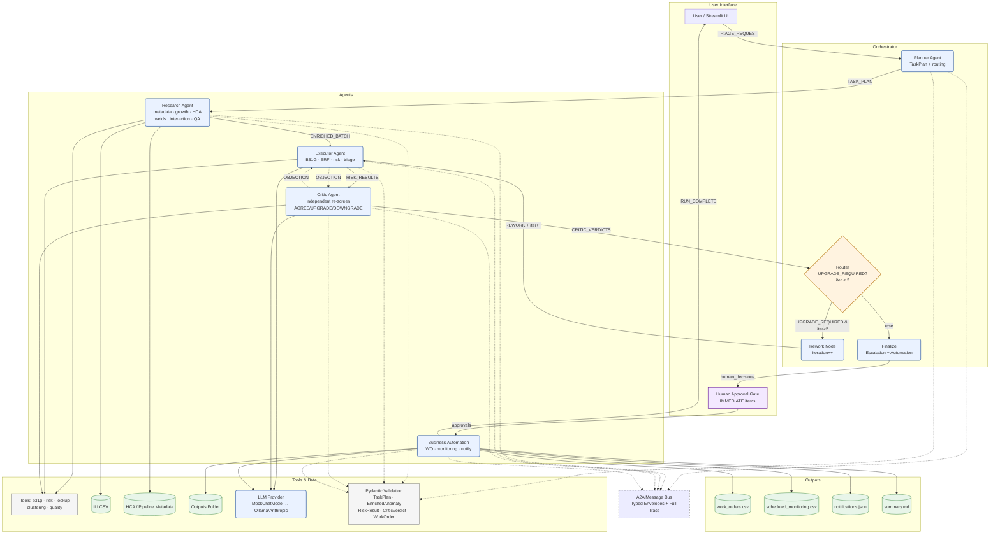

# CorrosionGuard Architecture Explained

This document describes the CorrosionGuard architecture in sufficient detail that someone can redraw the system diagram in draw.io without reading the code.

---

## 1. System Overview (One Paragraph)

CorrosionGuard is an offline, agentic AI system that triages pipeline corrosion anomalies from In-Line Inspection (ILI) runs. A Streamlit UI accepts a run request and anomaly data (CSV). A LangGraph state machine orchestrates five agents: **Planner** (produces a visible task plan), **Research** (enriches each anomaly with pipeline metadata, growth rates, HCA confirmation, neighbour proximity, interaction clustering, data quality flags, and inspector-note keyword scan), **Executor** (computes B31G safe pressure, ERF, 2-year depth projection, weighted risk score, and a numbers-only triage class), **Critic** (independently re-screens using full context rules — HCA, crossings, welds, interactions, note-vs-number contradictions, legacy label comparison — and emits AGREE / DOWNGRADE_RISK / UPGRADE_REQUIRED), and **Business Automation** (generates work orders for IMMEDIATE/60_DAY, a scheduled monitoring list for 180_DAY, an engineer summary, and simulated notification payloads). The Critic's UPGRADE_REQUIRED verdicts trigger a rework loop (max 2 iterations) where the Executor re-runs in conservative mode with critic-supplied constraints (depth/growth bumps, forced interaction/HCA/note flags). Unresolved upgrades after 2 iterations are **ESCALATED** to the more severe class. A human approval gate in the UI blocks IMMEDIATE work orders until explicitly approved. Every inter-agent handoff travels through a typed A2A message bus (trace_id, sender, receiver, intent, payload, timestamp) and is logged for full auditability. Pydantic schemas validate every agent output; validation failures are quarantined and logged. A deterministic MockChatModel (LangChain BaseChatModel subclass) provides rationales/summaries via template rendering; the LLM provider is a one-line swap for a real model (e.g., Ollama).

---

## 2. Component Table

| Component | Purpose | Inputs | Outputs | Tools Used |
|-----------|---------|--------|---------|------------|
| **User / Streamlit UI** | Human entry point: upload CSV, select scope, trigger run, approve IMMEDIATE items, download outputs | CSV file, run ID, pipeline filter, approval decisions | Run request, human decisions | Streamlit, pandas |
| **Planner Agent** | Parses request, counts anomalies/dirty records, emits dynamic task plan (tasks, owners, tools), selects routing (small/large batch), deep-check scope | Request string, anomaly count, dirty estimate | TaskPlan (tasks[], routing, deep_checks, narrative) | MockChatModel (template) |
| **Research Agent** | Enriches every anomaly: pipeline metadata lookup, growth rate from prior depth, HCA/location confirmation (with mismatch flags), nearby features (weld <5m, road, water), interaction clustering (axial gap ≤ 50×wall_thickness_mm + clock window ≤ 1.5h), data quality validation (missing/impossible/unit errors), inspector-note severe keyword scan | Raw anomaly rows (from CSV) | EnrichedAnomaly[] (growth_rate, hca_confirmed, interacting, interacting_with, near_weld, note_flags, note_severe, quality_flags) | pipeline_metadata, growth_rate, hca_lookup, nearby_features, find_interactions, validate_record, note_keywords |
| **Executor Agent (Risk Engine)** | Computes B31G safe pressure, ERF = MAOP/safe_pressure, 2-yr projected depth, weighted risk score (0.6×likelihood + 0.4×consequence with listed factors), triage class. On rework: applies critic constraints (depth_bump, growth_bump, force_interaction, force_hca, force_note_severe, assumed_depth) via conservative triage that includes context. | EnrichedAnomaly[], optional critic constraints | RiskResult[] (safe_pressure_mpa, erf, depth_pct_used, projected_depth_pct_2yr, risk_score, risk_factors, triage_class, rationale, trace) | safe_pressure_mpa, erf, project_depth, risk_score, executor_triage / executor_triage_conservative, MockChatModel (rationale) |
| **Critic Agent** | Independent re-screen using full context rules (different from Executor): depth, ERF, growth, HCA, crossings, welds, interaction, note-vs-number contradiction, legacy label comparison. Emits AGREE / DOWNGRADE_RISK / UPGRADE_REQUIRED with reasons. Flags missed-criticals (legacy < screen ≥ 60_DAY). Supplies constraints for rework (depth_bump, growth_bump, force_interaction, etc.). | EnrichedAnomaly[], RiskResult[], legacy_manual_label | CriticVerdict[] (executor_class, critic_screen_class, legacy_label, verdict, reasons, missed_critical, escalated, final_class), objections[] (anomaly_id, reasons, constraints) | full_screen_class, note_keywords, MockChatModel (objection text) |
| **Router (Decision Node)** | Conditional edge: if any UPGRADE_REQUIRED and iteration < 2 → "rework", else "finalize" | CriticVerdicts[], iteration | "rework" or "finalize" | — |
| **Rework Node** | Increments iteration counter, logs rework event to A2A bus | iteration, objected count | iteration+1 | — |
| **Human Approval Gate** (Streamlit UI) | Presents IMMEDIATE items with legacy/ERF context; user selects APPROVED/REJECTED per item. Headless runs auto-approve as AUTO_APPROVED_HEADLESS. | Final verdicts (IMMEDIATE subset) | approvals dict (anomaly_id → APPROVED/REJECTED/AUTO_APPROVED_HEADLESS) | Streamlit widgets |
| **Business Automation Agent** | Generates: (1) work_orders CSV (IMMEDIATE + 60_DAY only), (2) scheduled_monitoring CSV (180_DAY only), (3) notifications JSON (simulated email/Slack), (4) engineer summary Markdown. Status: IMMEDIATE → PENDING_APPROVAL until human approval; others → AUTO_APPROVED (headless = AUTO_APPROVED_HEADLESS). | EnrichedAnomaly[], final verdicts, RiskResults, run_id, approvals dict | work_orders_<run>.csv, scheduled_monitoring_<run>.csv, notifications_<run>.json, summary_<run>.md | csv, json, MockChatModel (summary, notification bodies) |
| **A2A Message Bus** | In-process typed envelope bus; every inter-agent handoff publishes a message; full trace available in UI and logs | AgentMessage (trace_id, sender, receiver, intent, payload, timestamp) | Log of all messages | In-memory list |
| **Tools Group** | Pure Python functions, no external deps, ready for MCP exposure | Varies per tool | Varies per tool | b31g (safe_pressure_mpa, erf), risk (risk_score, project_depth, executor_triage, executor_triage_conservative, full_screen_class), lookup (pipeline_metadata, growth_rate, hca_lookup, nearby_features, note_keywords), clustering (find_interactions), quality (validate_record) |
| **Data Stores** | ILI anomalies CSV (input), HCA/pipeline metadata (static dict in lookup.py), outputs folder (work orders, monitoring, notifications, summaries) | — | — | pandas, csv, json |
| **LLM Provider** | One-line swap interface: `LLM_BACKEND = "mock"` (default, offline) → MockChatModel (deterministic templates); `"ollama"` → ChatOllama; `"anthropic"` → ChatAnthropic. Real mode prepends a SystemMessage (facts come from deterministic tools; never change numbers/classes; 1-3 plain sentences) + per-tag hint; list-of-blocks content is normalised to a string; any exception falls back to the mock model. The LLM only writes prose and can only RAISE a note's severe flag (never lower), never touching numbers or severity classes. `LLM_RATIONALE_CLASSES` (default `IMMEDIATE,60_DAY`) caps real-mode prose calls to critical items. | Prompt with markers + facts | Rationale/summary/objection/note-assessment text | langchain_core.BaseChatModel |
| **Pydantic Validation Layer** | Validates every agent output (TaskPlan, EnrichedAnomaly, RiskResult, CriticVerdict, WorkOrder) inside graph nodes. Failures → logged to state["validation_errors"], record quarantined with `_validation_quarantined=True`, processing continues. | Agent output dict | Validated dict or quarantine record | pydantic.BaseModel |

---

## 3. Edge Table (A2A Message Intents)

| Source | Target | Intent / Label | Payload Summary |
|--------|--------|----------------|-----------------|
| User | Planner | `TRIAGE_REQUEST` | {request} |
| Planner | Research | `TASK_PLAN` | {tasks[], routing, deep_checks} |
| Research | Executor | `ENRICHED_BATCH` | {n, interacting, dirty} |
| Executor | Critic | `RISK_RESULTS` | {n, iteration, immediate_count} |
| Critic | Orchestrator | `CRITIC_VERDICTS` | {n_upgrades, n_missed, resolved_this_iter, remaining} |
| Critic | Executor | `OBJECTION` | {objections[{anomaly_id, reasons}], note} |
| Orchestrator | Executor | `REWORK` | {iteration, objected_anomalies} |
| Automation | User | `RUN_COMPLETE` | {n_work_orders, n_scheduled, metrics} |

---

## 4. Decision Points (Exactly as Implemented)

| Decision Point | Location | Condition | True Branch | False Branch |
|----------------|----------|-----------|-------------|--------------|
| **Router** | `router()` in builder.py | `any(verdict == "UPGRADE_REQUIRED") and iteration < MAX_ITERS (2)` | → `rework` node | → `finalize` node |
| **Escalation** | `n_finalize()` | `UPGRADE_REQUIRED` still true after MAX_ITERS | Force to more severe of executor/critic class; mark `escalated=True` | — |
| **Rework Resolution** | `n_critic()` on iter>0 | `executor_class >= critic_screen_class` (SEV order) | Mark resolved, verdict → AGREE | Remains UPGRADE_REQUIRED |
| **Human Gate** | Streamlit UI (page 6) | `final_class == "IMMEDIATE"` | Show approval widget (APPROVED/REJECTED) | Auto-approve (AUTO_APPROVED / AUTO_APPROVED_HEADLESS) |
| **Validation Failure** | `_validate_outputs()` in each node | Pydantic ValidationError | Log to `validation_errors`, quarantine record (`_validation_quarantined=True`), continue | Normal flow |
| **Rework Loop Exit** | `router()` | `iteration >= MAX_ITERS (2)` OR no UPGRADE_REQUIRED | → `finalize` | → `rework` |

---

## 5. Suggested draw.io Layout

### Swimlanes (Top to Bottom)
1. **User Interface** — Streamlit UI, Human Approval Gate
2. **Orchestrator** — Planner, Router, Rework, Finalize
3. **Agents** — Research, Executor, Critic, Business Automation
4. **Tools & Data** — Tools group (b31g, risk, lookup, clustering, quality), Data Stores (ILI CSV, HCA metadata, Outputs folder), LLM Provider + MockChatModel, Pydantic Validation Layer
5. **Outputs** — Work Orders CSV, Scheduled Monitoring CSV, Notifications JSON, Summary MD

### Shape & Colour Legend
- **Agents**: Rounded rectangle, fill `#EAF2FF`, border `#1F4E9C`
- **Tools**: Rectangle, fill `#F5F5F5`, border `#616161`
- **Data Stores**: Cylinder, fill `#E8F5E9`, border `#2E7D32`
- **Decision Diamonds**: Diamond, fill `#FFF3E0`, border `#B26A00`
- **Human Step**: Ellipse, fill `#F3E8FF`, border `#6A1B9A`
- **A2A Bus**: Dashed line, label "A2A Bus", colour `#333`
- **Feedback Loop**: Red curved arrow (`#C62828`) from Critic → Executor via Router/Rework

### Key Placement Notes
- Place **A2A Bus** as a vertical dashed line on the right of the Agents swimlane, with horizontal connectors from each agent to the bus.
- Draw the **Critic → Router → Rework → Executor** loop as a red curved arrow spanning the right side of the Agents swimlane.
- **Human Approval Gate** sits in the UI swimlane, connected to Automation.
- **Pydantic Validation Layer** shown as a thin wrapper around each agent node (or as a shared component in Tools & Data swimlane with validation arrows into each agent output).

---

## 6. Mermaid Flowchart (Paste into draw.io: Arrange → Insert → Advanced → Mermaid)

