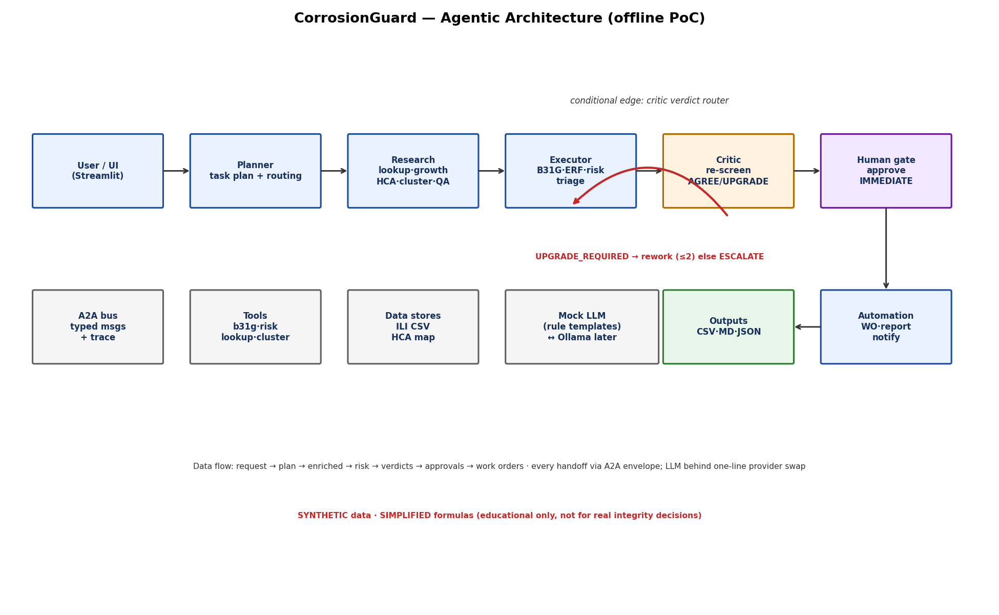

# CorrosionGuard — Architecture

## Runtime flow

```mermaid
flowchart TD
    U[User / Streamlit UI] --> P[Planner Agent<br/>task plan + routing]
    P -->|A2A TASK_PLAN| R[Research Agent<br/>metadata · growth · HCA · neighbours · quality]
    R -->|A2A ENRICHED_BATCH| E[Executor Agent<br/>B31G · ERF · risk score · triage]
    E -->|A2A RISK_RESULTS| C[Critic Agent<br/>independent re-screen]
    C -->|A2A CRITIC_VERDICTS| D{Router:<br/>UPGRADE_REQUIRED?}
    D -- yes, iter < 2 -->|A2A REWORK + constraints| E
    D -- yes, iter >= 2 --> ESC[Escalate:<br/>force more severe class]
    D -- no --> H[Human approval gate<br/>IMMEDIATE items]
    ESC --> H
    H --> A[Business Automation Agent<br/>work orders · report · notifications]
    A --> O[(Outputs<br/>CSV · MD · JSON on disk)]
    BUS[A2A Message Bus<br/>typed envelopes + full trace] -. every handoff .-> P
    BUS -.-> R
    BUS -.-> E
    BUS -.-> C
    BUS -.-> A
    T[Tools: b31g · risk · lookup · clustering · quality] -. used by .-> R
    T -. used by .-> E
    T -. used by .-> C
    S[(Data: ILI CSV · HCA map)] -. read by .-> R
    L[Mock LLM<br/>rule templates behind LLMProvider] -. rationales .-> E
    L -. objections .-> C
    L -. summaries .-> A
```



## Data-flow description

1. **Request** (`"Triage run ILI-2026-03 for pipeline P-14"` + anomaly rows) enters the Planner,
   which emits an ordered **TaskPlan** (tasks, owners, tools) and a routing decision
   (small vs large batch, deep checks on/off). The plan is shown in the UI.
2. **Research** enriches each row via tools: pipeline metadata, prior-inspection growth rate,
   HCA/location confirmation (with mismatch flags), weld/road/water proximity, interaction
   neighbours (chainage clustering, 1.0 m threshold), data-quality flags, and inspector-note
   keyword scan. Output: `EnrichedAnomaly` records.
3. **Executor** runs the physics/tool chain per anomaly — B31G safe pressure, ERF, 2-yr projected
   depth, weighted risk score with contributing factors — and assigns a numbers-only triage class.
   A Mock-LLM rationale is attached; every number carries a tool trace.
4. **Critic** re-derives an independent screen class with the *full* context rules (depth, ERF,
   growth, HCA/crossing/weld/interaction, note-vs-number contradiction, legacy-label comparison)
   and emits `AGREE / DOWNGRADE_RISK / UPGRADE_REQUIRED` plus a missed-critical flag.
5. The **router** loops `Critic → Executor` with conservative constraints (depth/growth bumps,
   forced interaction) up to **2 iterations**; unresolved upgrades are **escalated** to the more
   severe class and marked `ESCALATED`.
6. The **human gate** (Streamlit) approves/rejects IMMEDIATE items; **Automation** then writes
   work orders (due dates by class), an engineer summary, and simulated notification payloads
   (email/Slack JSON on disk — never sent).

## A2A messaging

Every handoff is a typed `AgentMessage` envelope
(`trace_id, sender, receiver, intent, payload, timestamp`) sent through the in-process
`MessageBus` (`src/graph/a2a.py`) and rendered in the UI trace tab. Agent Cards
(`AGENT_CARDS`) declare each agent's name, capabilities, inputs, outputs and tools.

## MCP (future scope, optional)

Tools in `src/tools/` are pure functions with typed signatures, ready to be exposed through an
MCP server (`mcp` package + `@mcp.tool` wrappers) so external agents can call B31G/ERF/risk
as remote tools. Not bundled (keeps the PoC offline with zero extra deps); the seam is the
`src/tools/` package boundary.
